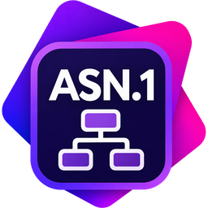

<p align="center">
  
</p>

# ASN.1 – JetBrains Plugin

Language support for ASN.1 (Abstract Syntax Notation One, ITU-T X.680) module definition files in all JetBrains
IDEs.

> [!NOTE]
> **AI transparency notice:** the code and documentation of this project were largely created with AI assistance
> (transparency notice pursuant to the EU AI Act).

## Documentation

* User documentation (MkDocs, published on GitHub Pages): <https://kleinerhacker.github.io/intellij-plugin.asn1/>
* Run locally: `./gradlew runDocs`
* API documentation (Dokka) and licence report are part of the published documentation

## About

### Features

* ASN.1 file type for `.asn` and `.asn1` files with a dedicated icon
* Parsing of the module header (module name, object identifier, encoding, tag and extension defaults)
* Syntax highlighting, color settings page and brace matching
* Completion of the tag default (`EXPLICIT TAGS`, `IMPLICIT TAGS`, `AUTOMATIC TAGS`)
* Completion of the module keywords `DEFINITIONS`, `BEGIN` and `END`
* Error tolerant parsing: incomplete text never breaks the editor

### IDE Compatibility

* IntelliJ IDEA, Rider, CLion and GoLand, version 2026.3 and newer (build 263+)

## Implementation Status

Reference: [ITU-T X.680](https://www.itu.int/rec/T-REC-X.680) — last checked: 2026-11-25

### File Types

| Feature                     | Status      |
|-----------------------------|-------------|
| `.asn` / `.asn1` file types | Implemented |

### Module Definition (X.680, clause 13)

| Feature                                                          | Status      |
|------------------------------------------------------------------|-------------|
| Module name and definitive object identifier (all forms)         | Implemented |
| `DEFINITIONS`, `::=`, `BEGIN`, `END`                             | Implemented |
| Encoding reference default (`XER INSTRUCTIONS`)                  | Implemented |
| Tag default (`EXPLICIT`, `IMPLICIT`, `AUTOMATIC TAGS`)           | Implemented |
| Extension default (`EXTENSIBILITY IMPLIED`)                      | Implemented |
| IRI value behind the object identifier                           | Planned     |
| Module body (exports, imports, assignments)                      | Planned     |

### Object Identifier Value (X.680, clause 32)

| Feature                                         | Status      |
|-------------------------------------------------|-------------|
| Name, number and name with number forms         | Implemented |
| Reference to a defined value as component       | Partial     |

### Editor Features

| Feature                                                     | Status      |
|-------------------------------------------------------------|-------------|
| Syntax highlighting and color settings page                 | Implemented |
| Brace matching                                              | Implemented |
| Completion of the tag default                               | Implemented |
| Completion of `DEFINITIONS`, `BEGIN` and `END`              | Implemented |
| Error tolerant parsing while typing                         | Implemented |
| Further completion, navigation, refactoring, formatting     | Planned     |

## Getting Started (Development)

### Prerequisites

* JDK 25 (resolved automatically by the Gradle toolchain)
* Internet access for the IntelliJ Platform download

### Build

```shell
git clone https://github.com/KleinerHacker/intellij-plugin.asn1.git
cd intellij-plugin.asn1
./gradlew build            # compile, test, assemble
./gradlew developerTest    # fast tests (all classes not named *IT)
./gradlew integrationTest  # tests named *IT
./gradlew buildPlugin      # plugin ZIP in plugin/build/distributions
```

### Run in a sandboxed IDE

```shell
./gradlew runIde
```

In IntelliJ IDEA the shared run configurations `Run Plugin`, `Run Tests` and `Run Verifications` in `.run` can be
used.

### Project Structure

```
asn-1
├── buildSrc    Gradle convention plugins
├── language    The ASN.1 language itself (never depends on plugin)
├── plugin      IDE specific extensions (settings, build, tool windows); depends on language
├── docs        MkDocs documentation
└── .github     CI and release pipelines
```

## Manual Installation

1. Build the plugin with `./gradlew buildPlugin` or download the ZIP from the GitHub release page.
2. In the IDE: *Settings → Plugins → ⚙ → Install Plugin from Disk…* and select the ZIP.

## Contributing

Issues and pull requests are welcome. Please use the issue templates in `.github/ISSUE_TEMPLATE`.

## Trademarks & Disclaimer

ASN.1 is standardised by the ITU-T. This project is not affiliated with or endorsed by the ITU.
JetBrains and IntelliJ are trademarks of JetBrains s.r.o.

## Licenses

Licensed under the [Apache License, Version 2.0](LICENSE). Third-party licences are listed in the published
documentation.
